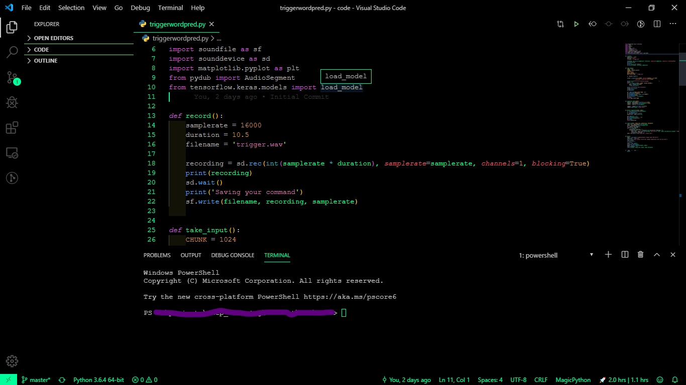
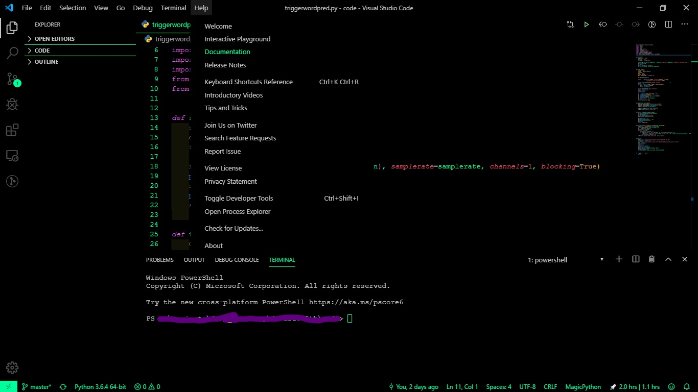

# Neon_SilverBlack
Neon silver font, pitch black theme for VS Code :)

Works in VS Code, Cursor, VSCodium, Google Cloud Shell Editor / Cloud Workstations and any other editor built on Code - OSS.

# Install

- **VS Code** – search for `Neon Silver Black` in the Extensions view, or install from the [Visual Studio Marketplace](https://marketplace.visualstudio.com/items?itemName=Jabor047.neon-silver-black-theme).
- **Cursor, VSCodium, Cloud Shell Editor, Cloud Workstations** – these use the [Open VSX Registry](https://open-vsx.org/extension/Jabor047/neon-silver-black-theme); search for `Neon Silver Black` in their Extensions view.
- **Manual** – download the `.vsix` from the [Releases page](https://github.com/Jabor047/Neon_SilverBlack/releases), then run **Extensions: Install from VSIX...** from the Command Palette.

Then open the Command Palette, run **Preferences: Color Theme** and pick **Neon Black Silver**.

# Screenshot

[Github Repo](https://github.com/Jabor047/Neon_SilverBlack)

**Enjoy Mate!**
